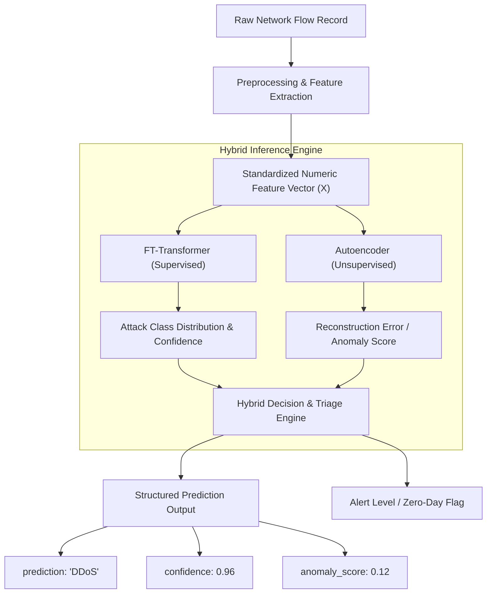

# Hybrid ML Model Training & Architecture Plan

**Project Title:** Hybrid ML-Based Intrusion Detection System
**Project ID:** SKIT/IOT/2023-2027/F-031
**Author / Role:** Nancy — Machine Learning and ML-Related Backend
**Milestone:** Week 6 — Initial Groundwork for Hybrid FT-Transformer + Autoencoder Pipeline
**Date:** October 2026

---

## 1. Architectural Philosophy & Purpose

Traditional Intrusion Detection Systems (IDS) generally rely either on signature-based supervised classifiers or purely unsupervised anomaly detectors:
- **Supervised Classifiers** excel at identifying *known* attack patterns with high precision, but frequently misclassify *novel, unseen, or zero-day attacks* as benign because the anomalous traffic does not fit known attack signatures.
- **Unsupervised Anomaly Detectors** (such as Autoencoders) learn the baseline distribution of nominal traffic and can flag unexpected deviations, but they cannot identify the specific attack family or provide fine-grained tactical classification.

To overcome both limitations, our project implements a **Hybrid Architecture** combining:
1. **FT-Transformer (Feature Tokenizer Transformer):** A state-of-the-art tabular neural architecture for supervised multi-class and binary attack classification.
2. **Deep Autoencoder:** A bottleneck reconstruction neural network trained on nominal benign traffic to produce an independent **anomaly score**.
3. **Hybrid Decision Engine:** A triage layer combining classifier confidence with reconstruction anomaly score to produce actionable, robust threat detection.



---

## 2. Component Architecture Specifications

### 2.1 Component 1: FT-Transformer (Supervised Classification)

The **Feature Tokenizer Transformer (FT-Transformer)** transforms tabular flow features into feature embeddings ("tokens") and processes them with stacked Transformer encoder blocks:

1. **Feature Tokenizer Layer:**
   - For numerical features $x_j \in \mathbb{R}$, each feature is projected into a $d$-dimensional embedding space:
     $$e_j = x_j \cdot W_j + b_j \quad \text{where } W_j \in \mathbb{R}^{d}, b_j \in \mathbb{R}^d$$
   - A learnable `[CLS]` token $e_{\text{cls}} \in \mathbb{R}^d$ is prepended to the sequence of tokens:
     $$E_0 = [e_{\text{cls}}, e_1, e_2, \dots, e_F] \in \mathbb{R}^{(F + 1) \times d}$$
2. **Transformer Encoder Blocks (2–4 layers):**
   - Multi-Head Self-Attention (MHSA) layer:
     $$\text{Attention}(Q, K, V) = \text{softmax}\left(\frac{QK^T}{\sqrt{d_k}}\right)V$$
   - Feed-Forward Network (FFN) with LayerNorm and residual skip connections.
   - Self-attention enables the model to explicitly capture non-linear, multi-way interactions between tabular network features (e.g., packet rate, flag combinations, and flow durations) without requiring manual feature-interaction engineering.
3. **Classification Head:**
   - The output embedding corresponding to the `[CLS]` token is passed through a Linear layer followed by Softmax:
     $$\hat{y} = \text{Softmax}(W_{\text{head}} \cdot h_{\text{cls}})$$
   - Generates the class prediction $\hat{c} = \arg\max \hat{y}$ and confidence score $p_{\max} = \max \hat{y}$.

---

### 2.2 Component 2: Deep Autoencoder (Reconstruction Anomaly Detection)

The Autoencoder functions as an unsupervised reconstruction model trained **strictly on benign traffic**:

1. **Encoder Network:**
   - Compresses the feature vector $x \in \mathbb{R}^F$ through progressively narrowing dense layers with LayerNorm and GELU activations:
     $$z = f_{\text{enc}}(x) \quad \text{where } z \in \mathbb{R}^{d_{\text{latent}}}, d_{\text{latent}} \ll F$$
2. **Decoder Network:**
   - Reconstructs the compressed latent representation back into the original feature space:
     $$\hat{x} = f_{\text{dec}}(z) \in \mathbb{R}^F$$
3. **Reconstruction Loss & Anomaly Score:**
   - Optimization objective during training on benign traffic:
     $$\mathcal{L}_{\text{recon}} = \text{MSE}(x, \hat{x}) = \frac{1}{F} \sum_{j=1}^F (x_j - \hat{x}_j)^2$$
   - **Anomaly Score Formulation:** For an incoming flow vector $x$, the normalized anomaly score is defined as:
     $$s_{\text{anomaly}} = \tanh\left(\frac{\|x - \hat{x}\|_2^2}{\tau_{\text{threshold}}}\right) \in [0.0, 1.0]$$
     where $\tau_{\text{threshold}}$ is the $95^{\text{th}}$ or $99^{\text{th}}$ percentile of reconstruction errors observed on the benign validation set.

---

### 2.3 Component 3: Hybrid Decision Strategy & Interface Contract

Consistent with `ml/inference/README.md` and backend integration specifications, the hybrid predictor outputs three core fields:

```json
{
  "prediction": "DDoS",
  "confidence": 0.96,
  "anomaly_score": 0.12
}
```

#### Decision Matrix & Triage Rules:

| Scenario | Classifier Prediction | Classifier Confidence | Autoencoder Anomaly Score | Hybrid Final Determination | Action / Alert Level |
| :--- | :--- | :--- | :--- | :--- | :--- |
| **1. Standard Benign** | `BENIGN` | High ($\ge 0.85$) | Low ($< \tau_{\text{threshold}}$) | **Benign Traffic** | Normal operation; no alert. |
| **2. Confirmed Known Attack** | Attack Class (e.g., `DDoS`) | High ($\ge 0.85$) | High ($\ge \tau_{\text{threshold}}$) | **Confirmed Attack** (`DDoS`) | High-priority mitigation; automated rule trigger. |
| **3. Suspected Zero-Day / Novel Attack** | `BENIGN` | High ($\ge 0.80$) | **High** ($\ge \tau_{\text{threshold}}$) | **Suspected Anomaly / Novel Threat** | **Crucial Triage:** Classifier was fooled, but autoencoder flagged anomalous feature profile. Quarantine and analyst review. |
| **4. Low-Confidence Ambiguity** | Attack or Benign | Low ($< 0.60$) | High ($\ge \tau_{\text{threshold}}$) | **Uncertain Anomaly** | Elevated logging; sandbox flow. |
| **5. Benign Fluke / Outlier** | Attack Class | Low ($< 0.60$) | Low ($< \tau_{\text{threshold}}$) | **Review Benign** | Prevent false alarm; passive inspection. |

---

## 3. Data Splitting & Leakage Prevention Strategy

### 3.1 Partitioning Protocol

To ensure reproducible, unbiased evaluation:
1. **Split Proportions:**
   - **Training Set (70%):** Model parameter optimization.
   - **Validation Set (15%):** Hyperparameter tuning, early stopping, and anomaly threshold calibration.
   - **Test Set (15%):** Final generalization benchmark (untouched during model selection).
2. **Stratification:**
   - Both datasets must be partitioned using **stratified splits** based on the multiclass attack label (`Label` for CICIDS2017, `Attack_Category` for CIC-IoT2023).
   - This ensures that minority attack categories (e.g. `Bot`, `Web Attack`, `Backdoor_Malware`) are proportionally distributed across Train, Val, and Test.

### 3.2 Data Leakage Prevention Rules

> [!CAUTION]
> **Strict Leakage Prevention Protocol:**
> 1. **No Fitting on Val/Test:** All scaling transforms (`StandardScaler`), encoders (`LabelEncoder`), and imputation statistics (median/mean) must be fitted **strictly on the Training set**. The Validation and Test sets are transformed using `.transform()` only.
> 2. **Exclude Non-Generalizable Features:** Metadata and identifiers must be stripped before feature matrices are formed:
>    - `Source_File` and `Dataset` (metadata).
>    - `Source IP`, `Destination IP`, `Source Port`, `Destination Port`, and `Timestamp` (environmental identifiers that lead to site-specific memorization rather than behavioral learning).
> 3. **Autoencoder Isolation:** The Autoencoder must be fitted **only on the benign records of the Training set** ($y_{\text{train}} == \text{BENIGN}$ / `Benign_Final`). If attack traffic is included in the Autoencoder's training data, it will learn to reconstruct attack flows, destroying its anomaly detection capability.

---

## 4. Class Imbalance Mitigation Strategy

As established in our Week 6 EDA report:
- CICIDS2017: 80.30% Benign, with rarest class `Heartbleed` having only 11 samples ($206,645 : 1$ ratio).
- CIC-IoT2023: 97.65% Attacks, with benign traffic representing only 2.35% ($42 : 1$ inverse ratio).

### 4.1 Recommended Strategy (Principled Approach)

1. **Avoid Naive Random Oversampling (ROS):**
   - Blindly duplicating tabular flow records creates identical rows in high-dimensional feature space, causing the Transformer's self-attention to overfit individual duplicate tokens.
2. **Class-Weighted Cross-Entropy Loss:**
   - Weight loss contributions inversely proportional to class frequency:
     $$w_c = \frac{N}{K \cdot N_c}$$
     where $N$ is total samples, $K$ is number of classes, and $N_c$ is sample count of class $c$.
3. **Focal Loss for Extreme Minority Classes:**
   - Implements hard-example mining:
     $$\mathcal{L}_{\text{focal}}(p_t) = -\alpha_t (1 - p_t)^\gamma \log(p_t)$$
     with focusing parameter $\gamma = 2.0$. This prevents gradient overwhelming from millions of easy benign flows while amplifying gradients for rare attack signatures.
4. **Stratified Mini-Batch Sampling:**
   - PyTorch `WeightedRandomSampler` to ensure that every mini-batch contains representations of both majority and minority classes during training.

---

## 5. Evaluation Metrics Framework

Because overall Accuracy is severely distorted by class imbalance, model evaluation will report:
1. **Primary Metrics:**
   - **Macro-Averaged F1-Score:** Unweighted average of F1 across all classes; treats minority classes with equal importance to the majority.
   - **Weighted F1-Score:** F1 weighted by class support.
   - **Class-Wise Precision & Recall:** Critical to determine false-positive rates on benign traffic and false-negative rates on critical attacks.
2. **Threshold-Independent Metrics:**
   - **PR-AUC (Precision-Recall Area Under Curve):** Far more informative than ROC-AUC on datasets with severe class skew.
3. **Operational Metrics:**
   - **Inference Latency (ms per sample):** Must meet near real-time requirements ($< 10\text{ ms}$ per micro-batch).
   - **Model Footprint (MB):** Model parameters must remain lightweight for local deployment.

---

## 6. Implementation Dependencies & Technical Risks

| Risk / Challenge | Severity | Mitigation Strategy |
| :--- | :--- | :--- |
| **1. Tabular Transformer Memory Overhead** | Medium | With $F = 78$ features, self-attention complexity is $O(F^2)$. Set embedding dimension $d = 32$ or $64$ and number of attention heads to 4–8 to keep memory usage $< 2\text{ GB}$ on CPU/GPU. |
| **2. Autoencoder Threshold Calibration** | Medium | Calibrate $\tau_{\text{threshold}}$ on benign validation reconstruction errors at the 99th percentile, ensuring a nominal false-positive rate of $\le 1\%$. |
| **3. Training Run Time on 46M Records** | High | Training on all 46.77M rows in CIC-IoT2023 on CPU is impractical. Sample a stratified balanced subset of 200,000–500,000 records for model optimization in Week 7. |
| **4. Extremely Rare Classes ($N < 50$)** | High | For `Infiltration` (36), `Web Attack - Sql Injection` (21), and `Heartbleed` (11), group them into broader families (e.g. `Web_Attacks` or `Advanced_Intrusions`) during initial training if single-class convergence fails. |

---

## 7. Model Groundwork Deliverables (Week 6)

To establish a solid, runnable foundation without prematurely claiming completed training results, this week introduces:
1. `ml/models/ft_transformer.py`: Runnable PyTorch implementation of the Feature Tokenizer and Transformer Classifier skeleton.
2. `ml/autoencoder/autoencoder.py`: Runnable PyTorch implementation of the Deep Autoencoder anomaly detector.
3. `ml/inference/hybrid_predictor.py`: Runnable hybrid decision engine combining FT-Transformer logits and Autoencoder reconstruction errors into the standard prediction contract.
4. `configs/ml_config.yaml`: Fully documented configuration schema covering data paths, split ratios, model dimensions, and training hyperparameters.
5. `tests/ml/test_model_preparation.py`: Lightweight unit tests verifying tensor shapes, forward passes, and thresholding logic.
