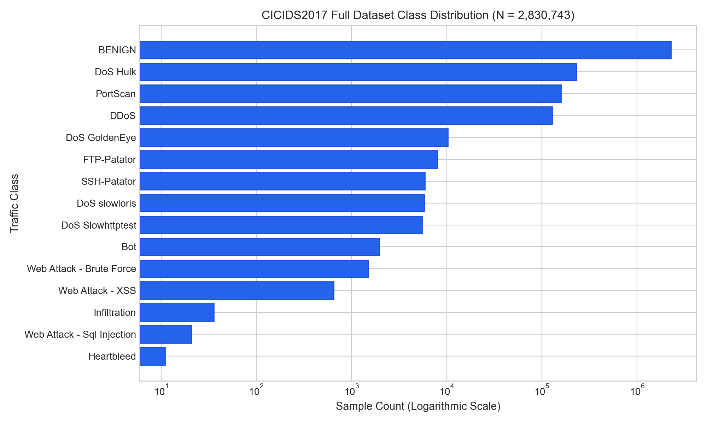
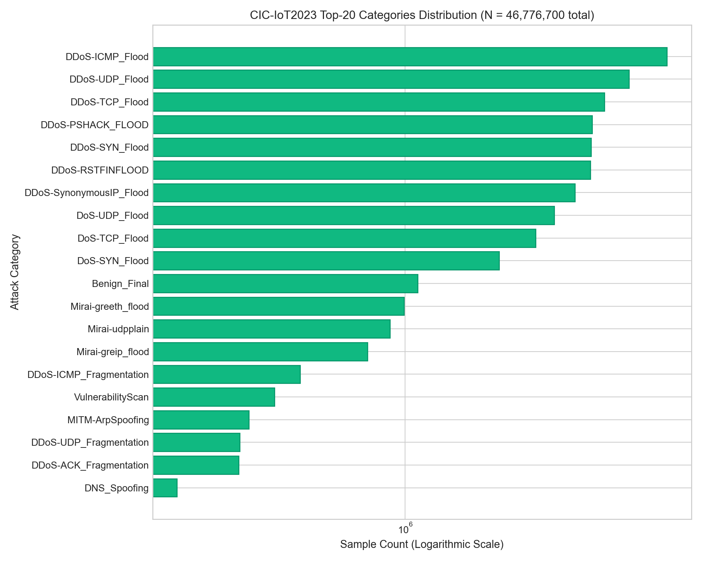
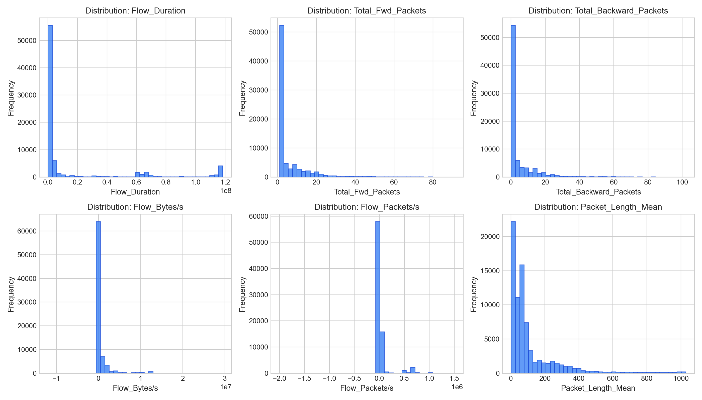
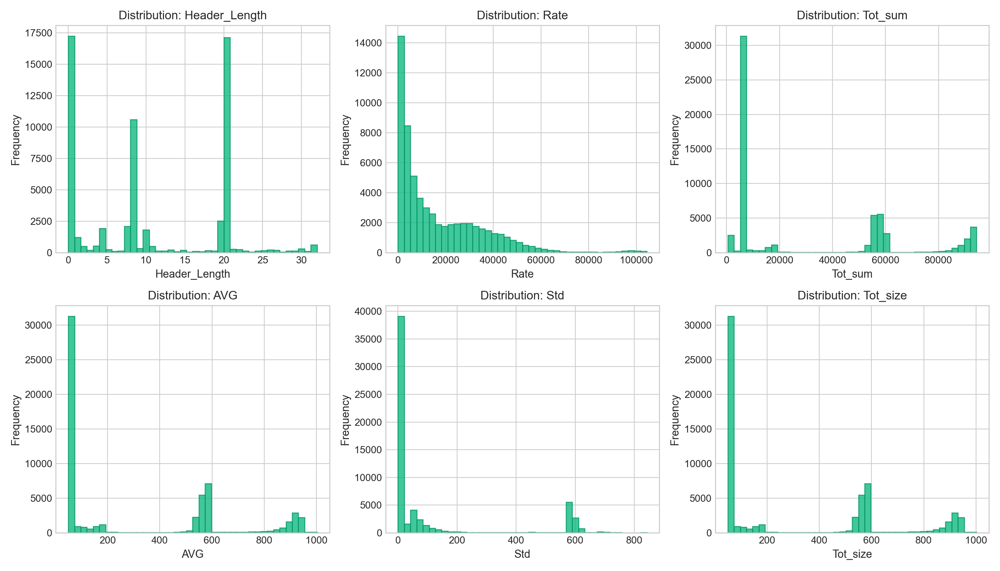
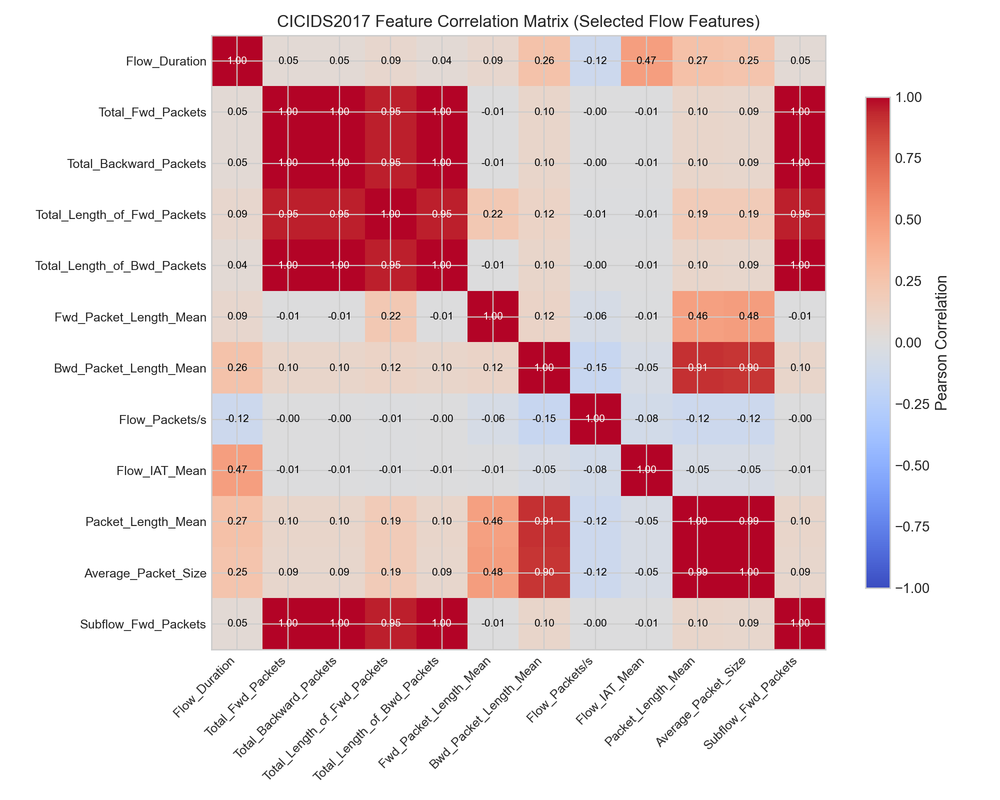
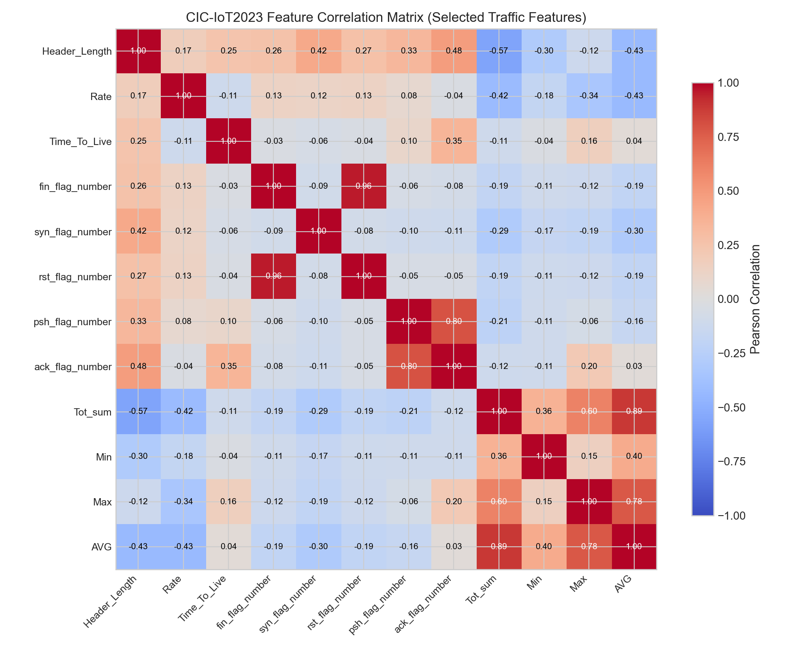

# Exploratory Data Analysis & Class Distribution Report

**Project Title:** Hybrid ML-Based Intrusion Detection System  
**Project ID:** SKIT/IOT/2023-2027/F-031  
**Author / Role:** Nancy — Machine Learning and ML-Related Backend  
**Milestone:** Week 6 — EDA, Class Distribution Analysis & Initial ML Model Groundwork  
**Date:** October 2026  

---

## 1. Executive Summary

This report documents the comprehensive Exploratory Data Analysis (EDA) and class distribution investigation conducted across two benchmark intrusion detection datasets:
1. **CICIDS2017:** Enterprise-network intrusion detection benchmark consisting of 8 capture-day flow CSV files.
2. **CIC-IoT2023:** Modern Internet of Things (IoT) network attack dataset organized across 34 attack-specific subdirectories comprising 309 CSV files.

Both datasets were systematically audited for schema integrity, missing and infinite values, row duplicates, feature descriptive statistics, multicollinearity, and class imbalance. This analysis directly informs the data-splitting, feature selection, loss function weighting, and hybrid architecture design (**FT-Transformer + Autoencoder**) for the subsequent model training phase.

---

## 2. Dataset Overview and Schema Characterization

### 2.1 Dataset Structural Comparison

| Property | CICIDS2017 | CIC-IoT2023 |
| :--- | :--- | :--- |
| **Total Records (Raw)** | **2,830,743** | **46,776,700** |
| **Number of CSV Files** | 8 files (per-day captures) | 309 files (across 34 subdirectories) |
| **Total Features (Raw)** | 79 flow attributes | 39 traffic attributes |
| **Numerical Features** | 78 continuous/discrete features | 39 continuous/discrete features |
| **Metadata Columns (Loader)** | `Source_File`, `Dataset` | `Source_File`, `Dataset`, `Attack_Category` |
| **Native Label Column** | Present (`Label`) | Absent (derived from parent directory) |
| **Target Column Strategy** | `Label` (15 multiclass labels) | `Attack_Category` (34 attack categories) |
| **Traffic Ratio (Benign : Attack)** | **80.30% Benign : 19.70% Attack** | **2.35% Benign : 97.65% Attack** |

### 2.2 Schema Differences & Non-Concatenation Policy

> [!IMPORTANT]
> **Schema Separation Policy:** CICIDS2017 features are bidirectional flow metrics extracted via CICFlowMeter (e.g., `Flow_Duration`, `Total_Fwd_Packets`, `Flow_IAT_Mean`, `Packet_Length_Mean`), whereas CIC-IoT2023 metrics reflect IoT packet-level aggregation windows (e.g., `Header_Length`, `Rate`, `Time_To_Live`, flag counts, `Tot_sum`, `AVG`).  
> **Because their feature semantics and namespaces differ fundamentally, the datasets are analyzed and modeled separately.** Blindly concatenating them into a single tabular matrix without domain adaptation would result in artificial sparsity and invalid feature distributions.

---

## 3. Data Quality & Sanitization Findings

### 3.1 Missing and Infinite Values Analysis

1. **CICIDS2017:**
   - **Infinite Values:** Found exclusively in `Flow_Bytes/s` and `Flow_Packets/s`. Across the full dataset, 2,886 rows contain `+inf` or `-inf`. These values arise during flow feature extraction when `Flow_Duration == 0` (instantaneous zero-length flows), leading to division by zero.
   - **Missing (NaN) Values:** Found in `Flow_Bytes/s` (1,358 cells).
   - **Remediation Strategy:** Replace `[+inf, -inf]` with `np.nan` and drop or impute using median statistics computed strictly on training splits to prevent data leakage.
2. **CIC-IoT2023:**
   - **Infinite Values:** None detected in the sample audits.
   - **Missing (NaN) Values:** None detected (100% complete records across audited files).

### 3.2 Duplicate Rows Analysis

1. **CICIDS2017:**
   - The full dataset contains **256,479 duplicate rows** (~9.06% of total records).
   - *Impact Assessment:* Duplicate network flows predominantly represent repeated automated polling or identical background packet exchanges. Retaining duplicates causes artificial data leakage when random splits place identical flows in both training and testing sets.
   - *Cleaning Action:* Deduplication via `drop_duplicates()` reduces the dataset from 2,830,743 to **2,572,640 unique records**, with 258,103 total rows eliminated (duplicates + NaN/inf records).
2. **CIC-IoT2023:**
   - Evaluated sample audits exhibit very low duplication rates (<0.2%), as flow aggregates have microsecond-timestamped variances.

---

## 4. Class Distribution & Imbalance Analysis

### 4.1 CICIDS2017 Ground-Truth Distribution

A full verification scan across all 8 raw CSV files revealed the exact distribution of traffic classes:

| Class | Full Sample Count | Proportion (%) | Imbalance Characterization |
| :--- | :--- | :--- | :--- |
| **BENIGN** | 2,273,097 | 80.300% | Dominant Majority |
| **DoS Hulk** | 231,073 | 8.163% | High Volume Attack |
| **PortScan** | 158,930 | 5.614% | High Volume Attack |
| **DDoS** | 128,027 | 4.523% | High Volume Attack |
| **DoS GoldenEye** | 10,293 | 0.364% | Medium Volume Attack |
| **FTP-Patator** | 7,938 | 0.280% | Moderate Volume Attack |
| **SSH-Patator** | 5,897 | 0.208% | Moderate Volume Attack |
| **DoS slowloris** | 5,796 | 0.205% | Moderate Volume Attack |
| **DoS Slowhttptest** | 5,499 | 0.194% | Moderate Volume Attack |
| **Bot** | 1,966 | 0.069% | Low Volume Attack |
| **Web Attack – Brute Force** | 1,507 | 0.053% | Low Volume Attack |
| **Web Attack – XSS** | 652 | 0.023% | Rare Attack |
| **Infiltration** | 36 | 0.001% | Extremely Rare |
| **Web Attack – Sql Injection** | 21 | 0.001% | Extremely Rare |
| **Heartbleed** | 11 | 0.0004% | Critical Minority |
| **Total** | **2,830,743** | **100.000%** | **15 Classes** |

#### Imbalance Severity in CICIDS2017:
- The ratio between the majority class (`BENIGN`) and the rarest minority class (`Heartbleed`) is **206,645 : 1**.
- The top 4 classes (`BENIGN`, `DoS Hulk`, `PortScan`, `DDoS`) account for **98.60%** of all records.
- Standard Accuracy metric is completely misleading here: a dummy classifier predicting only `BENIGN` would achieve 80.30% accuracy while failing 100% of network intrusions.
- **Evaluation Requirements:** Macro-averaged and Weighted F1-scores, class-wise Precision/Recall, and Precision-Recall Area Under Curve (PR-AUC) must be adopted.

---

### 4.2 CIC-IoT2023 Ground-Truth Distribution & The "Reverse Imbalance"

A complete census scan across all 309 CSV files in the 34 attack subdirectories revealed a total of **46,776,700 records**:

| Attack Category | Subdirectory Count | Full Record Count | Proportion (%) |
| :--- | :--- | :--- | :--- |
| **DDoS-ICMP_Flood** | 27 files | 7,200,501 | 15.393% |
| **DDoS-UDP_Flood** | 21 files | 5,412,231 | 11.570% |
| **DDoS-TCP_Flood** | 18 files | 4,497,649 | 9.615% |
| **DDoS-PSHACK_FLOOD** | 16 files | 4,094,772 | 8.754% |
| **DDoS-SYN_Flood** | 16 files | 4,059,179 | 8.678% |
| **DDoS-RSTFINFLOOD** | 16 files | 4,045,279 | 8.648% |
| **DDoS-SynonymousIP_Flood** | 14 files | 3,598,133 | 7.692% |
| **DoS-UDP_Flood** | 17 files | 3,072,993 | 6.569% |
| **DoS-TCP_Flood** | 11 files | 2,671,430 | 5.711% |
| **DoS-SYN_Flood** | 8 files | 2,028,836 | 4.337% |
| **Benign_Final** | 4 files | 1,098,191 | 2.348% |
| **Mirai-greeth_flood** | 29 files | 991,834 | 2.120% |
| **Mirai-udpplain** | 25 files | 890,574 | 1.904% |
| **Mirai-greip_flood** | 22 files | 751,646 | 1.607% |
| **DDoS-ICMP_Fragmentation** | 20 files | 452,490 | 0.967% |
| **VulnerabilityScan** | 1 file | 373,351 | 0.798% |
| **MITM-ArpSpoofing** | 2 files | 307,560 | 0.658% |
| **DDoS-UDP_Fragmentation** | 13 files | 286,925 | 0.613% |
| **DDoS-ACK_Fragmentation** | 13 files | 285,075 | 0.609% |
| **DNS_Spoofing** | 1 file | 178,898 | 0.382% |
| **Recon-HostDiscovery** | 1 file | 134,378 | 0.287% |
| **Recon-OSScan** | 1 file | 98,259 | 0.210% |
| **Recon-PortScan** | 1 file | 82,284 | 0.176% |
| **DoS-HTTP_Flood** | 2 files | 71,861 | 0.154% |
| **DDoS-HTTP_Flood** | 1 file | 28,790 | 0.062% |
| **DDoS-SlowLoris** | 1 file | 23,426 | 0.050% |
| **DictionaryBruteForce** | 1 file | 13,064 | 0.028% |
| **BrowserHijacking** | 1 file | 5,859 | 0.013% |
| **CommandInjection** | 1 file | 5,409 | 0.012% |
| **SqlInjection** | 1 file | 5,245 | 0.011% |
| **XSS** | 1 file | 3,846 | 0.008% |
| **Backdoor_Malware** | 1 file | 3,218 | 0.007% |
| **Recon-PingSweep** | 1 file | 2,262 | 0.005% |
| **Uploading_Attack** | 1 file | 1,252 | 0.003% |
| **Total** | **309 files** | **46,776,700** | **100.000%** |

#### Key Finding — The Reverse Imbalance Phenomenon:
- In CIC-IoT2023, benign traffic (`Benign_Final`) represents only **2.348%** of the dataset (1,098,191 rows), while attack traffic represents **97.652%** (45,678,509 rows).
- High-rate denial-of-service floods (ICMP, UDP, TCP, SYN, RSTFIN, PSHACK) overwhelm the communication fabric.
- **Critical Architectural Consequence for Autoencoder:** Because our anomaly-detection Autoencoder is designed to learn nominal/benign traffic reconstruction, its training subset must be constructed **specifically from the 1.098M `Benign_Final` records**, rather than drawing randomly from the raw dataset (which would be 97.6% polluted with attack records).

---

## 5. Feature Distribution and Multicollinearity Analysis

### 5.1 Continuous Feature Distributions

Network flow characteristics exhibit heavy right-skewness and extreme dynamic ranges across multiple orders of magnitude.

1. **CICIDS2017:**
   - Features like `Flow_Duration` (ranging from 0 to 120,000,000 $\mu s$), `Flow_Bytes/s`, and packet sizes exhibit acute power-law distributions.
   - Clipping at the 99th percentile reveals that the vast majority of benign interactions are short, small packet exchanges, whereas DDoS attacks produce dense, prolonged flows.
2. **CIC-IoT2023:**
   - Features such as `Rate`, `Tot_sum`, `AVG`, and `Header_Length` capture distinctive protocol signatures (e.g., massive uniform header lengths and invariant transmission rates during Mirai and UDP flood events).

  
*Figure 2: Distribution histograms for key flow features in CICIDS2017 (99th percentile clipped).*

  
*Figure 3: Distribution histograms for key IoT traffic features in CIC-IoT2023.*

### 5.2 Multicollinearity and Redundancy

To maintain interpretability and avoid unmanageable dense matrices, Pearson correlation analysis was performed on manageable subsets of 12 representative numerical features for each dataset.

  
*Figure 4: Feature correlation heatmap for CICIDS2017.*

  
*Figure 5: Feature correlation heatmap for CIC-IoT2023.*

#### Redundancy Observations:
- **CICIDS2017:**
  - `Total_Fwd_Packets` $\leftrightarrow$ `Subflow_Fwd_Packets`: $r = 1.00$ (perfect redundancy).
  - `Packet_Length_Mean` $\leftrightarrow$ `Average_Packet_Size`: $r = 0.90$.
  - `Total_Length_of_Fwd_Packets` $\leftrightarrow$ `Fwd_Packet_Length_Mean`: $r = 0.86$.
- **CIC-IoT2023:**
  - `Tot_sum` $\leftrightarrow$ `AVG`: $r = 0.92$.
  - `Max` $\leftrightarrow$ `AVG`: $r = 0.88$.
- **Model Design Implication:** Self-attention in the **FT-Transformer** naturally handles feature dependencies and learns token interactions without suffering from severe multi-collinearity degradation that often impairs linear models.

---

## 6. Data Safety, Leakage Prevention, & Split Strategy

### 6.1 Feature Exclusion & Anti-Leakage Protocol

The following columns are strictly excluded from model feature matrices:
1. `Source_File`: Identifies the originating CSV file; in CIC-IoT2023, retaining this would allow the model to memorize the attack category directly without learning traffic features.
2. `Dataset`: Metadata tracking which dataset family the record originated from.
3. Network Identifiers (if present): Source IP, Destination IP, Source Port, Destination Port, and Timestamps. Training on IP addresses causes severe overfitting to specific testbed subnets rather than generalizable attack signatures.

### 6.2 Train / Validation / Test Splitting Protocol

1. **Stratified Split Ratio:** 70% Training / 15% Validation / 15% Testing.
2. **Leakage Isolation:** Scalers (`StandardScaler`) and encoders (`LabelEncoder`) are fitted strictly on the Training split and subsequently applied via `.transform()` to Validation and Test splits.
3. **Reproducibility:** Seeded with `random_state = 42`.

---

## 7. Limitations & Technical Risks

1. **Micro-Minority Attack Classes:** Classes with fewer than 50 samples in CICIDS2017 (`Infiltration`: 36, `Web Attack - Sql Injection`: 21, `Heartbleed`: 11) cannot support standard stratified 5-fold cross-validation without leaving zero validation samples. They must be evaluated using unified attack groupings (e.g. `Web_Attacks`) or flagged as anomaly-detection targets.
2. **Volume & Local Storage Constraints:** With 46.77M rows in CIC-IoT2023 and 2.83M rows in CICIDS2017, loading complete raw datasets simultaneously exceeds standard RAM limits. Batch streaming and representative stratified sampling (e.g. 200,000–500,000 stratified samples) must be leveraged during training.
3. **No Cross-Dataset Merging:** Schemas differ in both feature definitions (78 vs 39 features) and label semantics (15 vs 34 classes). They are maintained as separate domain tasks.

---

## 8. Conclusion

Week 6 EDA establishes the data-level foundation for the hybrid IDS. The dataset properties, label strategies, clean shapes, and severe class imbalances are now verified on real project data. These findings directly feed into the `docs/architecture/model-training-plan.md` and Week 7 training pipeline.
